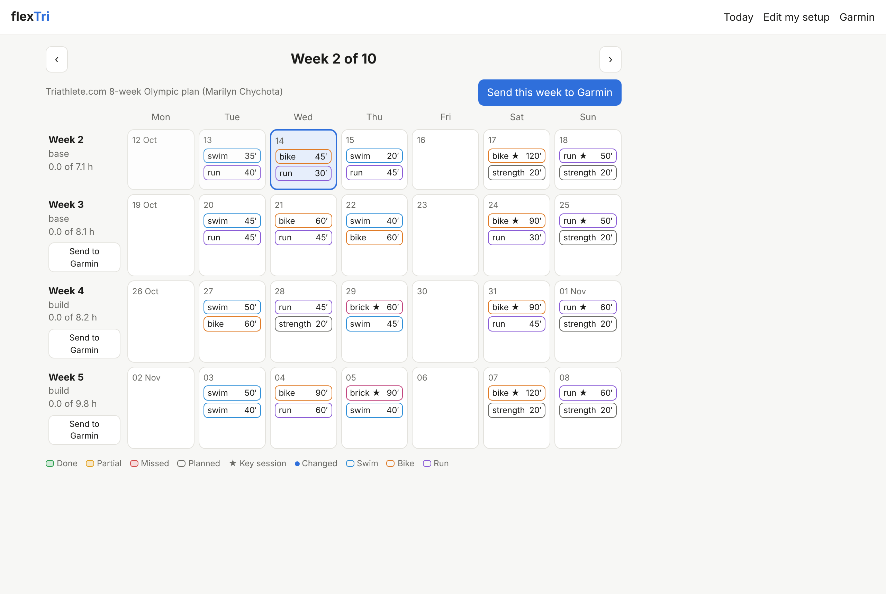
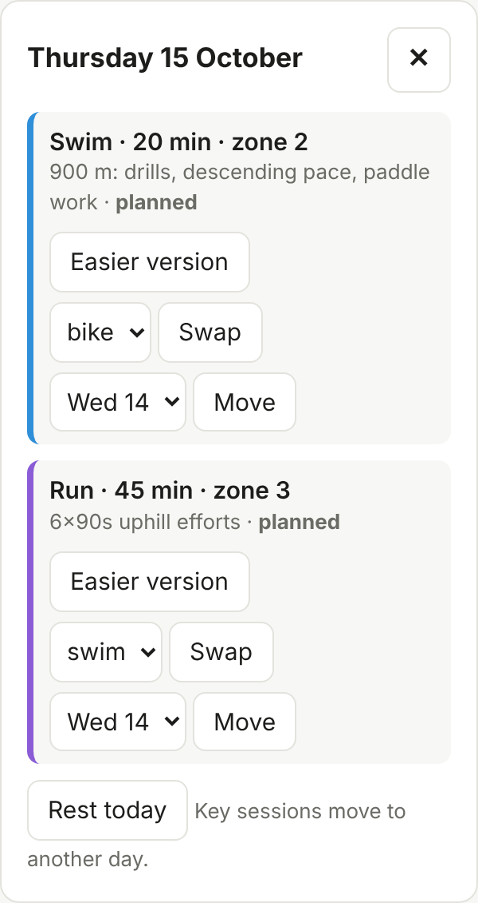
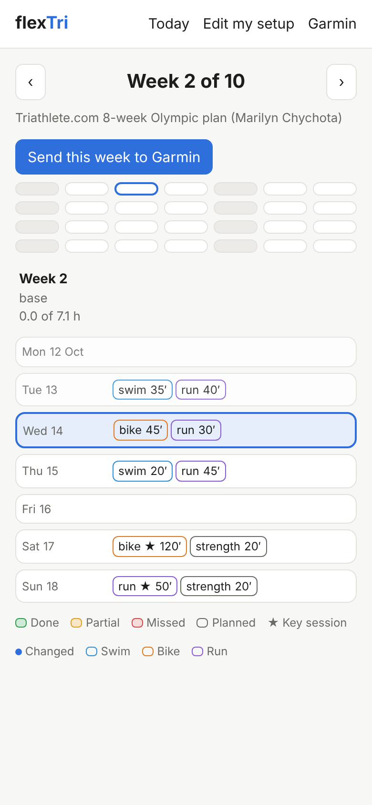

# The calendar

Press **Calendar** in the top bar to see four weeks at once, starting from the current week. Use the arrows to go back or forward.

<figure></figure>

How to read it:

- Each session shows its **sport and minutes**, colored by sport (swim, bike, run).
- **★** marks a **key session**: the long ride, long run, brick and other sessions the plan can't do without.
- The border color shows how it went: **done**, **partial**, **missed**, or still **planned**. A blue dot means flexTri changed the session.
- Next to each week: its phase (base, build, peak, taper) and how many hours you've done of the hours planned.

## Changing a day

Tap a day to open it. For each session you can:

- **Easier version**: a shorter, gentler version of the same session.
- **Swap**: change the sport, for example a run instead of a bike when your bike is in the shop. Easy sessions only.
- **Move**: put it on another day in the same week.
- **Check in**: the detailed check-in, with minutes, effort (1 to 10), tiredness and soreness (1 to 5) and notes.

And for the whole day:

- **Rest today**: clears the day. Key sessions are moved to another day rather than lost.
- **Add a session I did**: add something you did that wasn't in the plan, like a swim with friends.

Changed your mind? **Undo** at the top puts back the last change.

<figure class="phone"></figure>

## On a phone

On a narrow screen the calendar shows one week as a list, with a 28-day strip on top to jump between days.

<figure class="phone"></figure>
