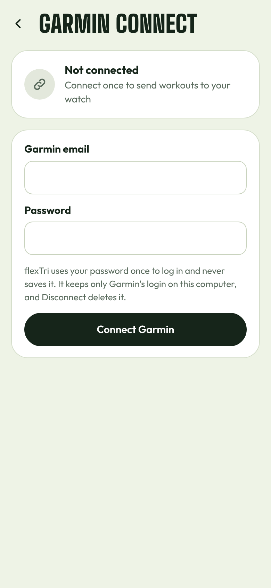
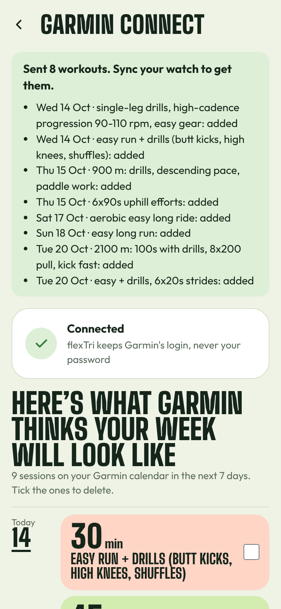
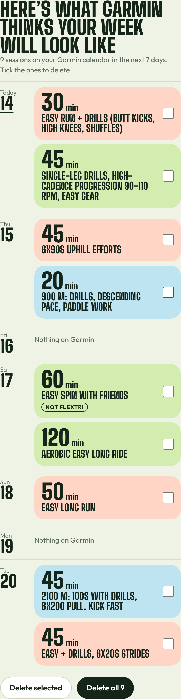
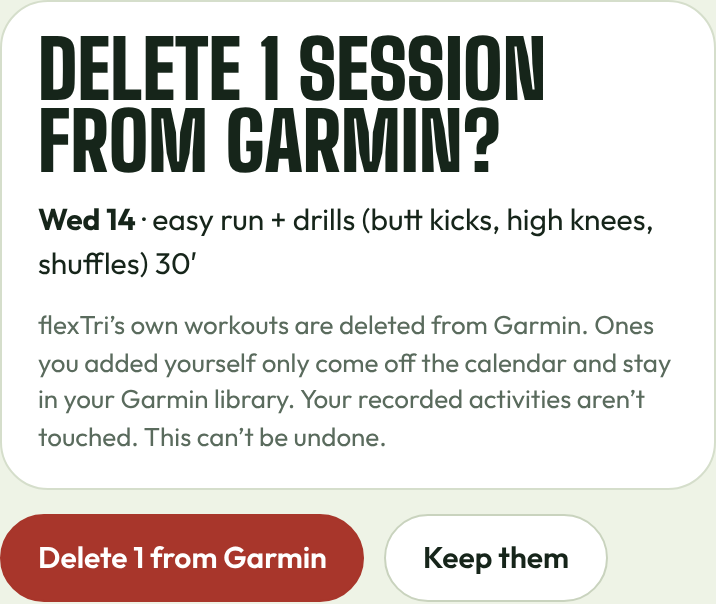

# Sending workouts to Garmin

If you have a Garmin watch, flexTri can put your planned sessions on your Garmin Connect calendar, so they show up on your watch after it syncs.

## Connect once

1. Press **Garmin** in the top bar.
2. Enter the email and password you use for Garmin Connect, and press **Connect Garmin**.
3. If Garmin sends you a code (by email or text), type it in.

flexTri uses your password once to log in and never saves it. It keeps only Garmin's login on your computer, and **Disconnect** at the bottom of the page deletes that too.

<figure class="phone"></figure>

## Send your week

Press **Send this week to Garmin** on Today or in the calendar, or **Send 7 days ahead to watch** on the Garmin page. flexTri sends the planned sessions for the next 7 days and lists what it added. Sessions that are already on Garmin are skipped, so pressing it twice is safe.

In the calendar, each later week has its own **Send to Garmin** button too.

**Then sync your watch** (in the Garmin Connect phone app, or the way you normally sync) to get the workouts on it.

<figure class="phone"></figure>

Changed your plan after sending? Check in or edit as usual, then send again: new or changed sessions get added.

## See what Garmin has for your week

The Garmin page shows **"Here's what Garmin thinks your week will look like"**: everything on your Garmin calendar for one week, read back from Garmin Connect. The weeks match your calendar: they start on the day you picked in setup and carry the same "Week N of M" label. Use ‹ and › to look at other weeks. Sessions you made in Garmin yourself are marked **Not flexTri**.

<figure class="phone"></figure>

## Delete sessions from Garmin

Tick the sessions you want gone and press **Delete selected**, or press **Delete all**. flexTri asks you to confirm first, because this can't be undone.

<figure class="phone"></figure>

What gets deleted:

- **flexTri's workouts** are removed from your Garmin calendar and deleted from Garmin.
- **Workouts you made yourself** in Garmin only come off the calendar. They stay in your Garmin workout library.
- **Your recorded activities are never touched.** Deleting only affects planned workouts, never the runs, rides and swims you've already done.

## Clean up your watch

Garmin watches can only hold a limited number of workouts. If yours is full of old ones (from another app, for example), press **Check** next to **Clean up watch**. flexTri finds workouts that were only scheduled in the past, shows you how many and a few names, and deletes them only if you confirm. Upcoming workouts, ones you saved yourself, and your recorded activities stay.

## If something goes wrong

- **Garmin asked for a code and nothing arrived**: check your spam folder, or press Cancel and log in again.
- **"Garmin Connect refused the upload"**: Garmin may be busy. Try again in a few minutes.
- **Workouts don't show on the watch**: sync the watch with Garmin Connect. Workouts appear on the watch's calendar for their day.

flexTri connects to Garmin Connect the same way the Garmin website does, because Garmin isn't accepting new apps on its official developer program right now. If Garmin changes its login, sending may stop working until flexTri is updated.
