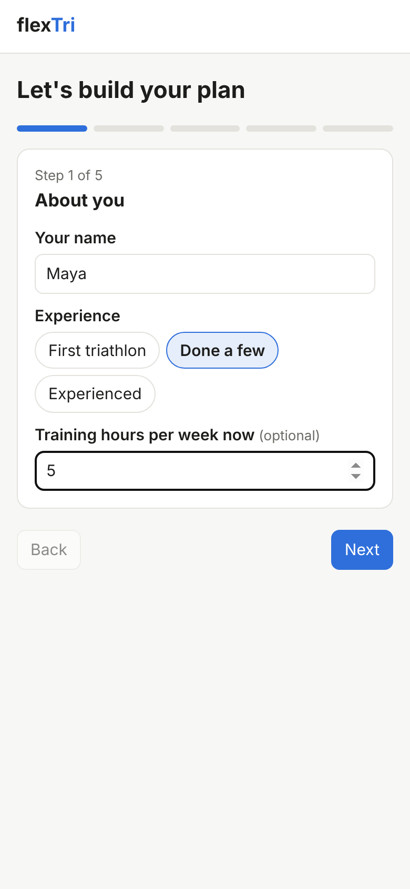
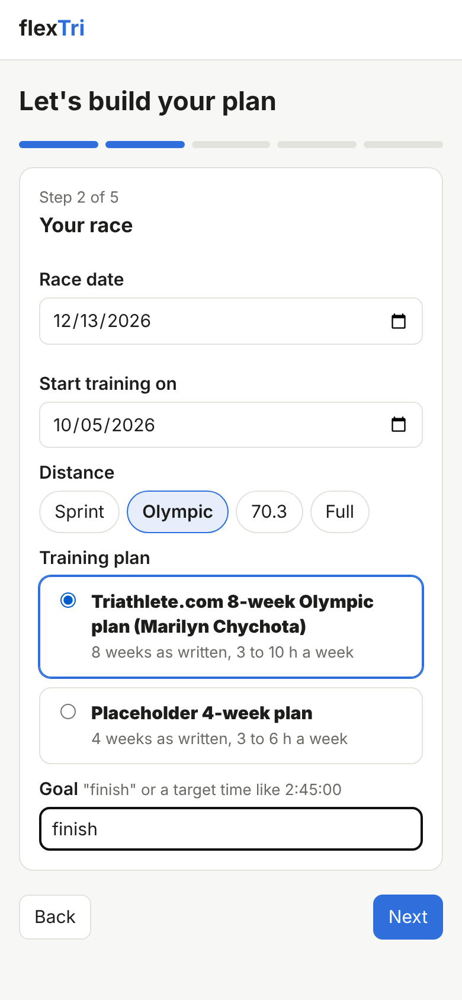
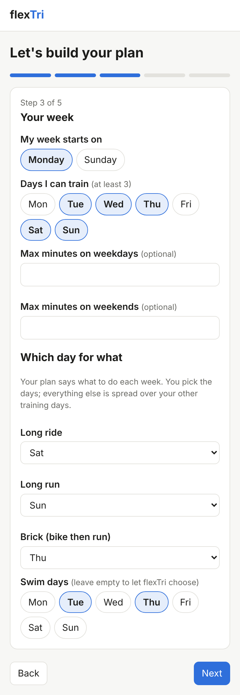
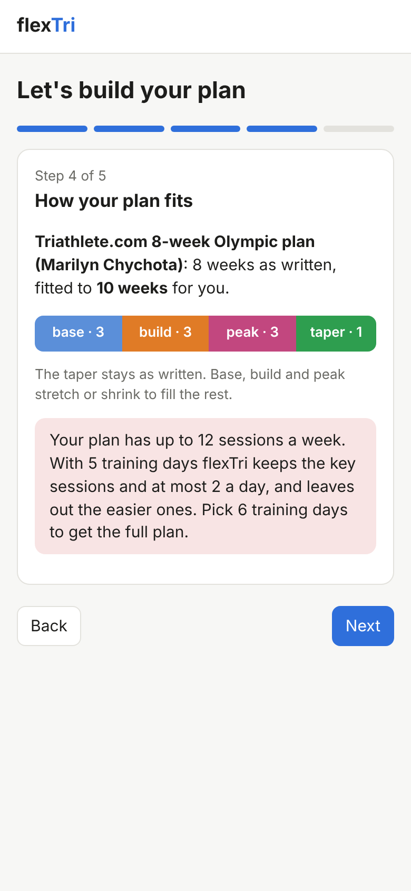
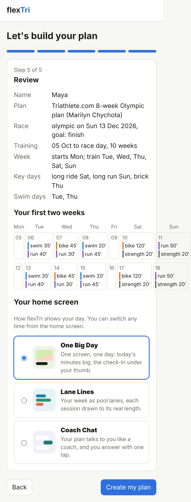

# Setup: building your plan

The first time you open flexTri, a short setup in 5 steps builds your plan. Nothing is saved until you press **Create my plan** at the end, and you can change all of it later with **Edit my setup**.

## Step 1: About you

Your name, how much triathlon experience you have, and (if you like) how many hours a week you train now.

<figure class="phone"></figure>

## Step 2: Your race

- **Race date**: the day of your race. The plan is built to end there.
- **Start training on**: the first day of training. It can be today, or a date in the future.
- **Distance**: Sprint, Olympic, 70.3 or Full.
- **Training plan**: the plan flexTri will fit to your weeks. Each plan says how many weeks it was written for and roughly how many hours a week it takes.
- **Goal**: "finish", or a target time like `2:45:00`.

<figure class="phone"></figure>

## Step 3: Your week

This is where the plan becomes yours. Plans in flexTri don't say "long ride on Saturday"; they say "this week has a long ride". You decide which day.

- **My week starts on**: Monday or Sunday. The calendar and the day lists follow your choice.
- **Days I can train**: at least 3. flexTri never puts a session on a day you didn't pick.
- **Max minutes on weekdays / weekends** (optional): a cap if your time is limited.
- **Long ride, Long run, Brick (bike then run)**: the day for each of these key sessions.
- **Swim days**: the days you can get to the pool. Leave them empty and flexTri picks.

Everything else in the week is spread over your other training days, with at most 2 sessions a day and never the same sport twice in one day.

<figure class="phone"></figure>

## Step 4: How your plan fits

flexTri shows how the plan was fitted to the weeks you have. In this example an 8-week plan is stretched to 10 weeks:

- The **taper** (the easy last week or so before the race) is kept exactly as written, because that's what gets you to the start line fresh.
- **Base, build and peak** stretch or shrink to fill the rest, keeping their order and their share of the plan.
- With very little time, the earliest weeks are the ones left out.

If you picked fewer training days than the plan needs, you'll see a note like the one below. flexTri keeps the key sessions and at least one swim, bike and run each week, and leaves out the easiest sessions. Go back and add a day if you want the full plan.

<figure class="phone"></figure>

## Step 5: Review and your home screen

Check the summary, then pick how your home screen looks. There are three looks, and you can switch any time from the bottom of the home screen. [See them here](today.html#three-looks).

Press **Create my plan** and you're done.

<figure class="phone"></figure>

## Changing your setup later

Press **Edit my setup** in the top bar at any time: new training days, a different long-run day, a new race date, or a new start date. Before you save, flexTri shows what will change.

- Days that are already past never change, and the sessions you logged stay.
- To restart the plan (after an injury or a break, for example), pick a new **Start training on** date, even today. The plan is fitted again from that date.
- The training plan itself is kept when you edit your setup.
