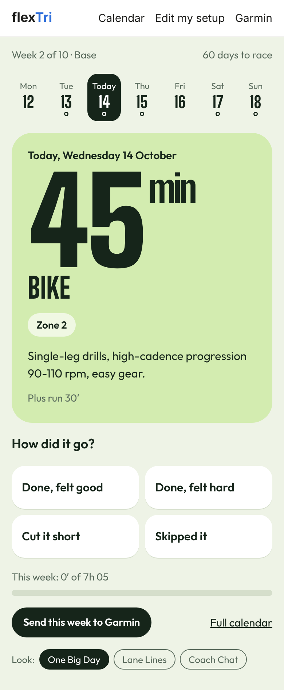
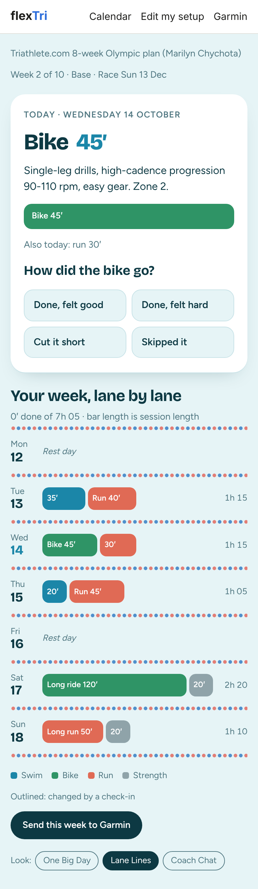
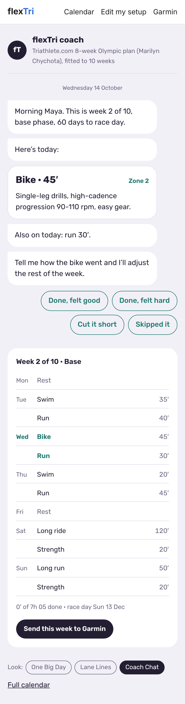
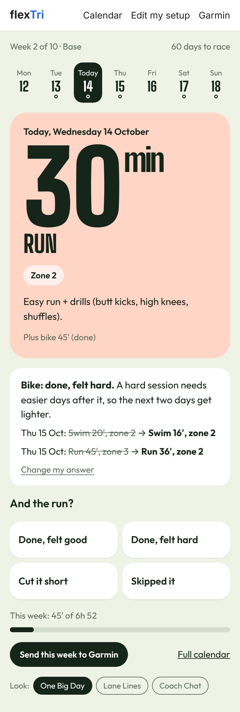

# Today and daily check-ins

The home screen is **Today**: what to do today, and four buttons to say how it went. That one tap is how flexTri keeps your plan realistic.

## The three looks {#three-looks}

All three show the same plan and work the same way. Pick the one you like in setup, or switch with the **Look** buttons at the bottom of the screen.

<figure><figcaption><strong>One Big Day</strong>: today's minutes, big, on a field colored by sport, with the week as a strip of days on top.</figcaption></figure>
<figure><figcaption><strong>Lane Lines</strong>: today on top, and your week below as pool lanes, each session drawn to its real length.</figcaption></figure>
<figure><figcaption><strong>Coach Chat</strong>: the plan talks to you like a coach, and you answer with one tap.</figcaption></figure>

## Checking in

After a session, open flexTri and tap the answer that fits best:

| You tap | What flexTri does |
| --- | --- |
| **Done, felt good** | Logs it. After three good, easy-feeling sessions in a row, your next few easy sessions grow by about 5%. |
| **Done, felt hard** | Logs it, and makes the next two days lighter: about 20% shorter and kept easy (zone 2). |
| **Cut it short** | Logs it as partly done. The rest of the week stays as planned. |
| **Skipped it** | If it was a **key session** (long ride, long run, brick and the like), it moves to the next free training day within 3 days. An easy session is simply let go, because missing one doesn't matter. |

Right after you tap, flexTri shows what changed, before and after, with a one-line reason. Tapped the wrong one? Press **Change my answer** and everything goes back as it was.

<figure class="phone"><figcaption>"Done, felt hard" on the bike: Thursday gets lighter. On a day with two sessions, flexTri then asks about the second one.</figcaption></figure>

## The rules behind it

flexTri's adjustments are simple on purpose, so you can always tell why something changed. Every change is noted on the session itself.

- **A missed key session moves** to the next free training day within 3 days. If an easy session is already on that day, it makes room. If there is no free day, the session is let go and flexTri tells you.
- **A missed easy session is let go.** The rest of the week stays.
- **A hard day eases the next two days**: about 20% shorter, capped at zone 2.
- **Very tired or very sore** (5 out of 5, from the detailed check-in on the calendar): tomorrow becomes a rest day.
- **Three fresh sessions in a row** (done, felt easy, not tired): the next easy sessions grow by 5%. Key sessions are never made longer.
- **Past days never change.** Only the days ahead adapt.

Want to give more detail, like your exact minutes, effort (1 to 10), tiredness and soreness? Use **Check in** on that day in the [calendar](calendar.html). You can check in for today or up to 2 days back.

## Race day

When race day comes, Today says so, and a **Race summary** link appears in the top bar. It shows how many sessions and key sessions you completed, your longest check-in streak, how many times the plan adapted along the way, and your hours per sport.
